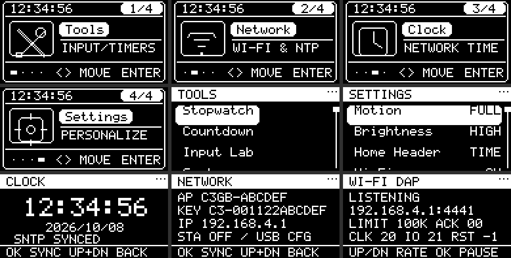
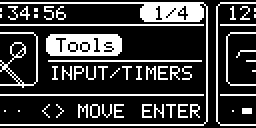

# ESP32-C3 GameBox

ESP32-C3 Super Mini / ESP-IDF 5.5.4 / C++20。SSD1306 **128×64 四线 SPI**，
复用 STM-GameBox 的菜单动画参数，加入 Wi-Fi 校时和外部 MCU 无线 SWD 调试。

已实现：

- 四卡片主页 Tools / Network / Clock / Settings，横向轮播、双页滑入、弹性光标和滚动；
- 独立高优先级按键任务：5 ms 采样、20 ms 去抖，Pressed 立即操作，
  长按、重复、单击、双击、组合返回和队列统计；
- Stopwatch、Countdown、Input Lab、System、Wi-Fi DAP、About；
- Wi-Fi AP+STA、退避重连、USB 命令配置、SNTP 自动和手动校时；
- Motion / Brightness / Home Header 设置，NVS 保存并合并 750 ms 内的修改；
- Wi-Fi CMSIS-DAP / SWD：OpenOCD TCP 4441、UDP 4442 发现、单客户端、
  协议边界检查、传输取消、断线及退出后恢复引脚高阻。

按用户确认选择 **Wi-Fi CMSIS-DAP/SWD 调试外部 MCU**。
本 ESP32-C3 的日志和配置通过原生 USB Serial/JTAG 控制台访问。
主页功能按本工程需求调整；参考工程的六款游戏没有移植。

## 菜单预览

由固件相同的 C++ 渲染器导出。预览使用示例时间与网络信息，实板显示自己的状态。

## 默认接线

已核对用户提供的 [Super Mini 引脚图](docs/hardware/pinout.png)。
图上标记 GPIO4=SCK、GPIO6=MOSI、GPIO7=SS、GPIO5=MISO。
屏幕无需 MISO，因此 GPIO5 改作 OLED RES。

| 功能 | GPIO | 连接 |
| --- | ---: | --- |
| OLED SCLK / D0 / SCL | 4 | 屏幕 SPI 时钟 |
| OLED MOSI / D1 / SDA | 6 | 屏幕 SPI 数据 |
| OLED CS | 7 | 屏幕 CS# |
| OLED DC | 10 | 屏幕 D/C# |
| OLED RES | 5 | 屏幕 RES# |
| OLED VCC / GND | — | 3V3 / GND |
| Up | 0 | 按键另一端接 GND |
| Down | 1 | 按键另一端接 GND |
| Enter | 3 | 按键另一端接 GND |
| 外部目标 SWCLK | 20 | STM32 常见 PA14 |
| 外部目标 SWDIO | 21 | STM32 常见 PA13 |
| 外部目标 GND | — | 两板共地 |
| 外部目标 NRST | 默认禁用 | 可配置，不能与已有功能冲突 |

屏幕仅使用 SPI2_HOST，Mode 0、8 MHz、DMA；Flash 的 SPI 留给系统。
默认不占用 GPIO2/8/9 启动配置脚及板载 LED/BOOT，GPIO18/19 留给原生 USB。
GPIO20/21 用作 SWD 后不再作 UART0 控制台。
接线可在 menuconfig → C3 GameBox 修改；冲突、未引出 GPIO、
USB 占用或未经允许的启动配置脚会触发编译错误。

外部目标自行供电，直接接线要求 3.3 V 逻辑；本板没有目标电压检测或电平转换。
使用短线，首次连接从 100 kHz 上限开始。

## 操作

- Up / Down 切换卡片或列表；Enter 立即确认，动画不锁输入。
- **同时按 Up+Down 返回**，默认没有独立 Back 键。
- 长按 Enter 也能返回，但它会先执行 Pressed 的确认，优先使用 Up+Down。
- Stopwatch：Enter 启停，Up 清零。Countdown：停止时 Up/Down 调分钟，Enter 启停。
- Clock / Network：Enter 请求校时。需要 STA 接入互联网，设备热点本身不能校时。
- Settings：Enter 循环动画 Off / Reduced / Full、四档亮度、
  主页 Time / Date / Pet / Title；Wi-Fi 项开关无线。
- Tools → Wi-Fi DAP 启用探针；Up/Down 选上限，Enter 暂停/恢复，返回时关闭服务。
- 可选 Function 键单按清零计时器、双击打开 Clock、长按打开 Input Lab。
  Left/Right、Jump、Back 等扩展键默认关闭，按 GPIO 预算配置。

## 构建与烧录

当前 esp-dev 内 SDK 为 /opt/esp-idf，工程映射为 /workspace/espc3-integrated。
脚本也兼容 /opt/esp/idf 和已有 IDF_PATH：

~~~bash
docker exec -w /workspace/espc3-integrated esp-dev bash tools/idf.sh build
docker exec -it -w /workspace/espc3-integrated esp-dev bash tools/idf.sh menuconfig
docker exec -it -w /workspace/espc3-integrated esp-dev bash tools/idf.sh -p /dev/ttyACM0 flash monitor
~~~

串口名是示例，先核对实际端口。默认 Flash 4 MiB，应用分区 3 MiB；
烧录前确认板载容量。退出 monitor 使用 Ctrl+]。

~~~text
build/idf/espc3_integrated.elf
build/idf/espc3_integrated.bin
build/idf/bootloader/bootloader.bin
build/idf/partition_table/partition-table.bin
~~~

## 联网和校时

默认开启热点 C3GB-xxxxxx。密码首次自动生成并保存到 NVS，
在 Network 页面或 USB 控制台的 wifi 命令中查看。
CONFIG_C3_AP_PASSWORD 可覆盖自动密码。

USB 控制台（含空格的 SSID/密码使用双引号）：

~~~text
help
wifi
wifi set "你的SSID" "你的密码"
status
ntp
~~~

STA 凭据保存到 NVS，重启后自动连接。默认时区 CST-8（UTC+8），
SNTP 服务器 ntp.aliyun.com / pool.ntp.org，周期一小时。
未获得有效时间时显示 --:--:--。完全断电后需要联网重新校时；
本工程没有配置电池 RTC。NVS 未启用加密，凭据保存在设备 Flash；
不要提交含密码的 sdkconfig。

## 无线 SWD

打开 Tools → Wi-Fi DAP，让电脑连接热点或与设备处于同一局域网。
屏幕显示 TCP 地址。OpenOCD 必须支持 cmsis-dap backend tcp。

~~~bash
python3 tools/dap_client.py discover
python3 tools/dap_client.py info --host 192.168.4.1
python3 tools/dap_client.py smoke --host 192.168.4.1 --count 100 --fragment

openocd -c "set DAP_HOST 192.168.4.1" \
  -f tools/openocd/c3-wifi.cfg -f target/stm32f1x.cfg \
  -c "init; targets; shutdown"
~~~

信息检查只查询探针身份，不访问外部目标。OpenOCD 配置需按实际 MCU 替换。
烧录、GDB、NRST、协议和验收见 [无线调试说明](docs/wireless-debug.md)。

## 本地测试

~~~bash
docker exec -w /workspace/espc3-integrated esp-dev bash tools/check.sh
docker exec -w /workspace/espc3-integrated esp-dev python3 tools/previews.py
~~~

测试使用 ASan/UBSan，覆盖输入、动画、快速导航、计时回绕、引脚策略、
生命周期回滚、包边界、SWD 引擎和 Python 客户端分片与错误报文。
[实板验收清单](docs/hardware-validation.md)区分主机验证与接线实测。

USB 连接实板后，可运行集成测试；串口脚本使用 SDK 环境里的 pyserial/esptool：

~~~bash
docker exec -w /workspace/espc3-integrated esp-dev bash -lc \
  'source /opt/esp-idf/export.sh && python tools/serial_smoke.py --port /dev/ttyACM0'
python3 tools/wifi_smoke.py --host 设备的STA地址
~~~

串口集成测试会临时修改显示设置并重启两次，验证 NVS 后恢复原设置。
它会注入菜单按键并测试计时器、Wi-Fi/DAP 启停，结束后 DAP 关闭。
无线集成测试只查询探针信息，包含分片、错误帧、单客户端和超时检查。
测试结果保存在 build/hardware/；USB status 可查看当前页面、设置和计时状态。

## 结构和依赖

- [架构与任务边界](docs/architecture.md)
- [本地依赖和来源](THIRD_PARTY.md)
- [当前验证记录](docs/validation.md)

应用组件和第三方源码在 components/，没有远程组件清单或构建时拉取。
ESP-IDF、FreeRTOS、lwIP、NVS 和工具链由现有本地 SDK 提供，不复制整套 SDK。

驱动依据 [ESP-IDF SPI 文档](https://docs.espressif.com/projects/esp-idf/en/v5.5.4/esp32c3/api-reference/peripherals/spi_master.html)、
[GPIO 文档](https://docs.espressif.com/projects/esp-idf/en/v5.5.4/esp32c3/api-reference/peripherals/gpio.html)和
[SNTP 接口](https://docs.espressif.com/projects/esp-idf/en/v5.5.4/esp32c3/api-reference/network/esp_netif_programming.html)。
