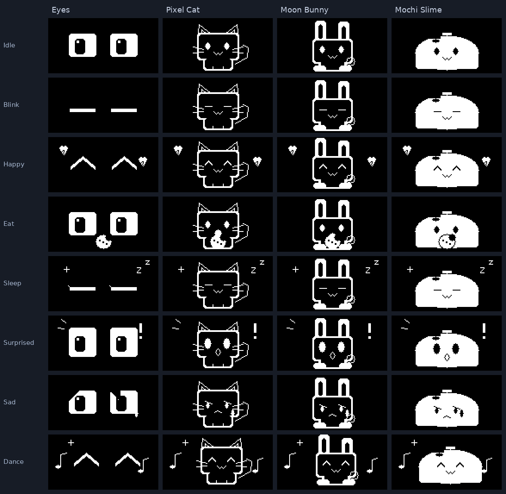
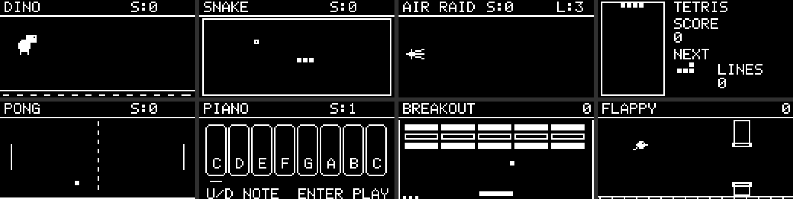

# ESP32-C3 GameBox

ESP32-C3 Super Mini / ESP-IDF 5.5.4 / C++20。SSD1306 **128×64 四线 SPI**，
复用 STM-GameBox 的菜单动画参数，加入 Wi-Fi 校时和外部 MCU 无线 SWD 调试。

已实现：

- 六卡片主页 Games / Tools / Network / Clock / Settings / Desktop Pet，横向轮播、双页滑入、弹性光标和滚动；
- 全屏桌宠：灵动双眼、像素猫、月兔、糯米史莱姆；八种动作，支持 wl1-studio 自定义像素动画并下载保存；
- STM-GameBox 的 Dino、Snake、Air Raid、Tetris、Pong、Piano，Up / Down / Enter 操作，独立 Back 退出；
- 新增 Breakout 打砖块、Flappy 飞鸟，八款统一开始、暂停、重开与返回；
- 独立高优先级按键任务：5 ms 采样、20 ms 去抖，Pressed 立即操作，
  长按、重复、单击、双击、独立退出键和队列统计；
- Stopwatch、Countdown、Input Lab、System、Wi-Fi DAP、About；
- Wi-Fi AP+STA、退避重连、USB 命令配置、SNTP 自动和手动校时；
- 无线电脑监控：wl1-studio 采集 Windows / Linux 的 CPU、RAM 与 NVIDIA GPU / 显存 / 温度，
  UDP 推送到 Tools → PC Monitor，支持数据过期提示和断网恢复；
- Motion / Brightness / Home Header 设置，NVS 保存并合并 750 ms 内的修改；
- Wi-Fi CMSIS-DAP / SWD：OpenOCD TCP 4441、UDP 4442 发现、单客户端、
  协议边界检查、传输取消、断线及退出后恢复引脚高阻。

按用户确认选择 **Wi-Fi CMSIS-DAP/SWD 调试外部 MCU**。
本 ESP32-C3 的日志和配置通过原生 USB Serial/JTAG 控制台访问。
游戏从 Games 卡片进入；原有工具、网络、时钟及设置继续可用。

## 桌宠

主页选择 **Desktop Pet**，桌宠占满 128×64 屏幕。Up/Down 切换样式，Enter 单击开心、
双击喂食、长按睡觉；睡眠时 Up/Down/Enter 先唤醒，单击 Back 直接返回主页。
桌宠会自然呼吸、眨眼和四处看，闲置 60 秒睡觉。

在 `/home/kk/kk_data/rust_project/wl1-studio` 运行桌面版，打开 **ESP-C3 桌宠**，
连接 `/dev/ttyACM0`，即可切换四种内置样式、触发八种动作，或编辑自己的动画。
工作台支持逐帧绘制、图片转单色、JSON 导入导出和下载到设备；浏览器版可离线设计预览。
自定义动画及所选样式保存到 NVS，断开上位机后继续播放。
重启进入主页，再次打开桌宠会使用保存的样式。

使用步骤、动作映射和上传协议见 [桌宠模式](docs/pet-mode.md)。

## 游戏

进入游戏后先显示操作说明，按 Enter 开始。**长按 Enter 暂停**，
暂停后 Enter 继续、Up 重开；失败后 Enter 回到开始画面。
**单击 Back 退出键返回游戏列表**，再单击一次返回主页。
准备、进行、暂停及结束画面均可退出；按住退出键只返回一级，松开后再按才返回下一级。
Tetris 长按 Enter 只暂停；其他游戏长按前会先执行对应的按下动作。

| 游戏 | Up / Down | Enter |
| --- | --- | --- |
| Dino | Up 跳跃 | 跳跃 |
| Snake | 相对当前朝向左转 / 右转 | 长按暂停 |
| Air Raid | 上移 / 下移，可按住 | 发射子弹 |
| Tetris | 左移 / 右移 | 单击旋转；双击硬降 |
| Pong | 左侧球拍上移 / 下移，可按住 | 长按暂停 |
| Piano | 选择前一个 / 后一个音符 | 弹奏 |
| Breakout | 球拍左移 / 右移 | 发球 |
| Flappy | Up 扇翅 | 扇翅 |

Pong 默认对战电脑；配置扩展 Left / Right 键后，首次按下它们即切换为双人模式，
由这两个键控制右侧球拍。三键 Snake 使用相对转向。
Tetris 在松开 Enter 并确认单击后旋转（双击判定窗口 150 ms）；
双击直接硬降，保持当前朝向；长按只暂停。

Piano 默认仅显示八个琴键和弹奏反馈。声音需要外接**无源蜂鸣器**，在
menuconfig → C3 GameBox → Board wiring 中设置 `C3_BUZZER_GPIO`，默认 -1 禁用。
引脚必须空闲并通过现有冲突检查；默认接线已使用全部非启动配置 GPIO，
GPIO2 已分配给退出键，需调整接线或按实际启动电平允许空闲 GPIO8/9。蜂鸣器驱动使用 LEDC PWM，
单音 180 ms，暂停和退出立即静音。

## 菜单预览

由固件相同的 C++ 渲染器导出。预览使用示例时间与网络信息，实板显示自己的状态。

## 默认接线

已核对用户提供的 [Super Mini 引脚图](docs/hardware/pinout.png)。
图上标记 GPIO4=SCK、GPIO6=MOSI、GPIO7=SS、GPIO5=MISO。
屏幕无需 MISO，因此 GPIO5 改作 OLED RES。

| 功能 | GPIO | 连接 |
| --- | ---: | --- |
| OLED SCLK / D0 / SCL | 4 | 屏幕 SPI 时钟 |
| OLED MOSI / D1 / SDA | 6 | 屏幕 SPI 数据 |
| OLED CS | 7 | 屏幕 CS# |
| OLED DC | 10 | 屏幕 D/C# |
| OLED RES | 5 | 屏幕 RES# |
| OLED VCC / GND | — | 3V3 / GND |
| Up | 0 | 按键另一端接 GND |
| Down | 1 | 按键另一端接 GND |
| Enter | 3 | 按键另一端接 GND |
| Exit / Back | 2 | 常开按键另一端接 GND；建议加 10 kΩ 上拉至 3V3 |
| 外部目标 SWCLK | 20 | STM32 常见 PA14 |
| 外部目标 SWDIO | 21 | STM32 常见 PA13 |
| 外部目标 GND | — | 两板共地 |
| 外部目标 NRST | 默认禁用 | 可配置，不能与已有功能冲突 |

屏幕仅使用 SPI2_HOST，Mode 0、8 MHz、DMA；Flash 的 SPI 留给系统。
GPIO2 原先空闲，现作为低电平有效的独立退出键。固件运行时启用内部上拉，
建议外接 10 kΩ 电阻从 GPIO2 上拉至 3V3，保证复位期间的电平；上电和复位时松开退出键。
GPIO2 是启动配置脚；[乐鑫数据手册 §3.1](https://www.espressif.com/sites/default/files/documentation/esp32-c3_datasheet_en.pdf)
说明它实际不决定 SPI/下载启动模式，但为避免毛刺仍建议上拉。
其余空闲脚 GPIO8 接板载 LED、GPIO9 接 BOOT，保留不占用；GPIO18/19 留给原生 USB。
GPIO20/21 用作 SWD 后不再作 UART0 控制台。
接线可在 menuconfig → C3 GameBox 修改；冲突、未引出 GPIO、
USB 占用或未经允许的启动配置脚会触发编译错误。
仅 Back 输入允许默认使用 GPIO2，全局 `C3_ALLOW_STRAPPING_PINS` 仍关闭。
已有 `sdkconfig` 的工程需把 `CONFIG_C3_KEY_BACK` 从 -1 改为 2；本次实板配置已更新。

~~~text
3V3 ── 10 kΩ ──┬── GPIO2（板上标记 2 / A2）
               └── 常开退出按键 ── GND
~~~

外部目标自行供电，直接接线要求 3.3 V 逻辑；本板没有目标电压检测或电平转换。
使用短线，首次连接从 100 kHz 上限开始。

## 操作

- Up / Down 切换卡片或列表；Enter 立即确认，动画不锁输入。
- **单击独立 Back / Exit 键返回一级**；主页按退出键保持主页。
- Up+Down 和普通页面长按 Enter 不再返回；游戏长按 Enter 仍暂停，桌宠长按 Enter 仍睡觉。
- 退出键去抖后立即响应，不等待双击窗口；长按、连发及延迟单击/双击事件不会继续退页。
- Stopwatch：Enter 启停，Up 清零。Countdown：停止时 Up/Down 调分钟，Enter 启停。
- Clock / Network：Enter 请求校时。需要 STA 接入互联网，设备热点本身不能校时。
- Settings：Enter 循环动画 Off / Reduced / Full、四档亮度、
  主页 Time / Date / Pet / Title；Wi-Fi 项开关无线。
- Tools → Wi-Fi DAP 启用探针；Up/Down 选上限，Enter 暂停/恢复，返回时关闭服务。
- 可选 Function 键单按清零计时器、双击打开 Clock、长按打开 Input Lab。
  Left/Right、Jump 等扩展键默认关闭，按 GPIO 预算配置。

## 构建与烧录

当前 esp-dev 内 SDK 为 /opt/esp-idf，工程映射为 /workspace/espc3-integrated。
脚本也兼容 /opt/esp/idf 和已有 IDF_PATH：

~~~bash
docker exec -w /workspace/espc3-integrated esp-dev bash tools/idf.sh build
docker exec -it -w /workspace/espc3-integrated esp-dev bash tools/idf.sh menuconfig
docker exec -it -w /workspace/espc3-integrated esp-dev bash tools/idf.sh -p /dev/ttyACM0 flash monitor
~~~

串口名是示例，先核对实际端口。默认 Flash 4 MiB，应用分区 3 MiB；
烧录前确认板载容量。退出 monitor 使用 Ctrl+]。

~~~text
build/idf/espc3_integrated.elf
build/idf/espc3_integrated.bin
build/idf/bootloader/bootloader.bin
build/idf/partition_table/partition-table.bin
~~~

## 联网和校时

默认开启热点 C3GB-xxxxxx。密码首次自动生成并保存到 NVS，
在 Network 页面或 USB 控制台的 wifi 命令中查看。
CONFIG_C3_AP_PASSWORD 可覆盖自动密码。

USB 控制台（含空格的 SSID/密码使用双引号）：

~~~text
help
wifi
wifi set "你的SSID" "你的密码"
status
ntp
~~~

STA 凭据保存到 NVS，重启后自动连接。默认时区 CST-8（UTC+8），
SNTP 服务器 ntp.aliyun.com / pool.ntp.org，周期一小时。
未获得有效时间时显示 --:--:--。完全断电后需要联网重新校时；
本工程没有配置电池 RTC。NVS 未启用加密，凭据保存在设备 Flash；
不要提交含密码的 sdkconfig。

## 无线电脑监控

在 wl1-studio 的 **ESP-C3 桌宠 → 电脑监控** 填写设备 STA 地址并开始监控，
MCU 打开 **Tools → PC Monitor**；Up / Down / Enter 切换总览与详情，Back 返回。
电脑与设备处于同一网络即可，无需 USB 数据连接。默认 500 ms 更新，
超过 3 秒未更新显示过期；切换电脑端页面或最小化继续运行，退出应用停止。

完整使用步骤、UDP 协议和实板验证见 [无线电脑监控](docs/pc-monitor.md)。

## 无线 SWD

打开 Tools → Wi-Fi DAP，让电脑连接热点或与设备处于同一局域网。
屏幕显示 TCP 地址。OpenOCD 必须支持 cmsis-dap backend tcp。

~~~bash
python3 tools/dap_client.py discover
python3 tools/dap_client.py info --host 192.168.4.1
python3 tools/dap_client.py smoke --host 192.168.4.1 --count 100 --fragment

openocd -c "set DAP_HOST 192.168.4.1" \
  -f tools/openocd/c3-wifi.cfg -f target/stm32f1x.cfg \
  -c "init; targets; shutdown"
~~~

信息检查只查询探针身份，不访问外部目标。OpenOCD 配置需按实际 MCU 替换。
烧录、GDB、NRST、协议和验收见 [无线调试说明](docs/wireless-debug.md)。

## 本地测试

~~~bash
docker exec -w /workspace/espc3-integrated esp-dev bash tools/check.sh
docker exec -w /workspace/espc3-integrated esp-dev python3 tools/previews.py
~~~

测试使用 ASan/UBSan，覆盖输入、动画、快速导航、计时回绕、引脚策略、
生命周期回滚、包边界、SWD 引擎和 Python 客户端分片与错误报文。
[实板验收清单](docs/hardware-validation.md)区分主机验证与接线实测。

USB 连接实板后，可运行集成测试；串口脚本使用 SDK 环境里的 pyserial/esptool：

~~~bash
docker exec -w /workspace/espc3-integrated esp-dev bash -lc \
  'source /opt/esp-idf/export.sh && python tools/serial_smoke.py --port /dev/ttyACM0'
python3 tools/wifi_smoke.py --host 设备的STA地址
docker exec -w /workspace/espc3-integrated esp-dev bash -lc \
  'source /opt/esp-idf/export.sh && python tools/exit_smoke.py --port /dev/ttyACM0'
docker exec -w /workspace/espc3-integrated esp-dev bash -lc \
  'source /opt/esp-idf/export.sh && python tools/game_smoke.py --port /dev/ttyACM0'
~~~

串口集成测试会临时修改显示设置并重启两次，验证 NVS 后恢复原设置。
它会注入菜单按键并测试计时器、Wi-Fi/DAP 启停，结束后 DAP 关闭。
无线集成测试只查询探针信息，包含分片、错误帧、单客户端和超时检查。
游戏集成测试遍历八款游戏，验证开始、暂停、恢复、重进、琴键事件及资源余量。
退出专项遍历各页面、About 的两个来源、八款游戏的准备/进行/暂停状态及休眠桌宠，
检查 Back 一次只退一级、Enter 长按不返回及 DAP 退出停止。
串口测试注入已识别的按键事件；真实去抖序列由主机测试覆盖，实体按键接线仍需实测。
俄罗斯方块单双击专项使用同一 SDK Python 环境运行 `tools/tetris_smoke.py --port /dev/ttyACM0`，
逐次检查按下、释放、单击、双击和长按的方块朝向。
测试结果保存在 build/hardware/；USB status 可查看当前页面、设置和计时状态。
`status` 还包含 key_up_gpio / key_down_gpio / key_enter_gpio / key_back_gpio、
game / game_state / game_score / game_steps / ui_stack_free；
`key enter long` 可注入长按，`key up release` 可释放测试中按住的方向键。

## 结构和依赖

- [架构与任务边界](docs/architecture.md)
- [本地依赖和来源](THIRD_PARTY.md)
- [当前验证记录](docs/validation.md)

应用组件和第三方源码在 components/，没有远程组件清单或构建时拉取。
ESP-IDF、FreeRTOS、lwIP、NVS 和工具链由现有本地 SDK 提供，不复制整套 SDK。

驱动依据 [ESP-IDF SPI 文档](https://docs.espressif.com/projects/esp-idf/en/v5.5.4/esp32c3/api-reference/peripherals/spi_master.html)、
[GPIO 文档](https://docs.espressif.com/projects/esp-idf/en/v5.5.4/esp32c3/api-reference/peripherals/gpio.html)和
[SNTP 接口](https://docs.espressif.com/projects/esp-idf/en/v5.5.4/esp32c3/api-reference/network/esp_netif_programming.html)。
