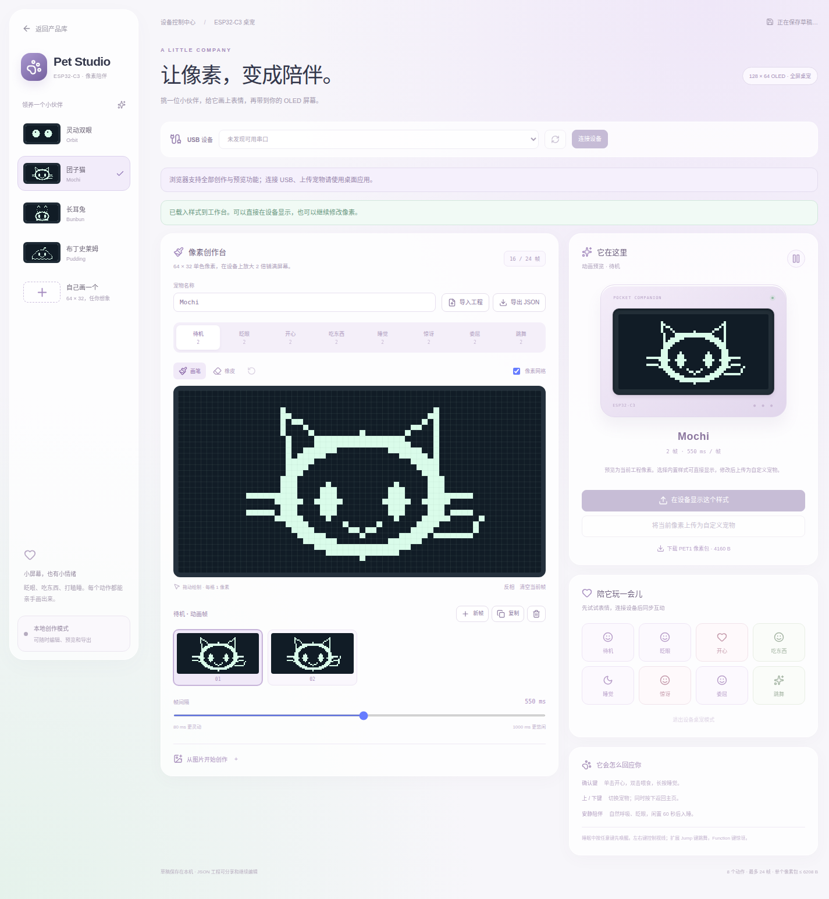

# OLED 全屏桌宠

主页第六张卡片 `Desktop Pet` 使用整个 128×64 屏幕。没有时间栏或操作提示遮挡宠物。

## 样式和动作

| 编号 | 样式 | 表现 |
| --- | --- | --- |
| 0 | 灵动双眼 Eyes | 大眼睛、眼神追踪、闭眼、爱心和惊讶表情 |
| 1 | 像素猫 Pixel Cat | 尖耳、胡须、尾巴、喂食和跳舞 |
| 2 | 月兔 Moon Bunny | 长耳朵、蹦跳、腮红与睡眠 |
| 3 | 糯米史莱姆 Mochi Slime | 弹性身体、呼吸起伏、表情与节奏摇摆 |
| 4 | 自定义 Custom | 上位机绘制或导入的逐帧单色动画 |

八种动作依次为 `idle`、`blink`、`happy`、`eat`、`sleep`、`surprised`、`sad`、`dance`。
待机和睡眠循环，其余动作播完回到待机。缺少的自定义动作使用待机帧。
内置宠物会自然呼吸、转动视线、眨眼，60 秒无操作后睡觉。

| 按键 | 动作 |
| --- | --- |
| Up / Down | 前一个 / 后一个样式；尚无自定义包时跳过 Custom |
| Enter 单击 | 开心、爱心反馈 |
| Enter 双击 | 喂食 |
| Enter 长按 | 睡觉 |
| 睡眠时任意键 | 先唤醒；本次操作不继续触发其它动作 |
| Up+Down / Back | 返回主页 |
| Left / Right（可选扩展键） | 向左 / 右看 |
| Jump（可选扩展键） | 跳舞 |
| Function（可选扩展键） | 惊讶 |

## wl1-studio 工作台

1. 在 wl1-studio 运行 `npm run tauri dev`，选择 **ESP-C3 桌宠**。
2. 选择串口（本机 `/dev/ttyACM0`）并连接。设备必须已刷入支持 `pet` 命令的固件。
3. 选择内置样式即可直接在 OLED 打开；动作按钮触发对应表情。
4. 选择预设作为起点或新建宠物，在 64×32 画布上逐帧绘制，也可把图片转成单色帧。
5. 为不同动作添加帧、设定帧间隔并预览。每动作至多 4 帧，总计至多 24 帧。
6. 下载到设备。进度完成后设备自动切换为自定义宠物，保存到 NVS。

工程自动保存在上位机本地，也可导出 JSON 备份或分享。设备只保留一个自定义包，
再次下载会替换；电脑可通过不同 JSON 文件保存多个宠物。
名称在设备包中使用至多 16 个 ASCII 字符；屏幕上只显示宠物画面。
浏览器 `npm run dev` 可编辑和预览；USB 下载需要桌面版。
USB 断开后当前桌宠继续运行；设备重启后进入主页，重新打开桌宠沿用已保存样式。
上位机串口会话与 WL1、GameBox 等产品的连接互斥。



## USB 命令

115200 / 8N1，ASCII 单行，以 LF 或 CRLF 结束。控制台有回显、`c3> ` 提示符和系统日志，
上位机仅识别完整的 `pet_ok VERB ...` / `pet_error REASON` 行，并逐条等待确认。
Ctrl-U 清理未完成的输入行。不要同时运行上位机、monitor 和测试脚本占用同一端口。

```text
pet status
pet open 1
pet action happy
pet action sleep
pet close
pet begin SIZE CRC32
pet chunk OFFSET HEX
pet commit
pet abort
```

`open` 的样式为 0..4；未安装自定义包时 4 返回错误。`action` 要求已打开桌宠。
`status` 返回 `active/style/action/sequence/custom/bytes`。
上传 CRC32 为整个包的标准 CRC32（IEEE，等同 Python zlib.crc32），用八位十六进制表示。
每次 chunk 最多 64 字节（128 个十六进制字符），OFFSET 是十进制且必须等于已接收字节数。
每条 ACK 返回 `next`。上传空闲 30 秒过期。只有完整包的 CRC、头部和帧数都通过校验，
并成功保存 NVS 后才替换当前宠物；失败可以 `abort` 或重新 `begin`。
`saved_apply_failed` 表示包已保存，但 UI 应用结果未确认；先查询 `pet status`，
包可能稍后生效或在设备重启时载入。

## PET1 二进制格式

| 偏移 | 长度 | 内容 |
| --- | ---: | --- |
| 0 | 4 | ASCII `PET1` |
| 4 | 4 | 宽64、高32、动作数8、保留0 |
| 8 | 16 | ASCII 名称，未用字节补零 |
| 24 | 8 | 按八种动作顺序存帧数 0..4，idle 必须至少1帧，总帧数≤24 |
| 32 | 16 | 每动作帧间隔，8个小端 uint16，80..1000ms |
| 48 | 16 | 保留，必须全0 |
| 64 | 可变 | 按动作顺序连续存帧，每帧256字节 |

位图按行排列，每行8字节，从每字节最高位开始；1为白，0为黑。
大小严格等于 `64 + 256 × 总帧数`，最小320、最大6208字节。

## 验证

主机 ASan/UBSan 测试包含包边界、缺失动作、逐像素2倍显示、手势隔离、
自然休眠、时间回绕和全屏页面生命周期。

```bash
docker exec -w /workspace/espc3-integrated esp-dev bash tools/check.sh
docker exec -w /workspace/espc3-integrated esp-dev bash -lc \
  'source /opt/esp-idf/export.sh && python tools/pet_smoke.py --port /dev/ttyACM0'
```

实机脚本会写入测试宠物并验证最大包替换和重启恢复，结束时切到内置猫咪。
日志及结果在 `build/hardware/pet-smoke.{log,json}`。OLED SPI 没有像素回读，
画面外观由相同核心渲染器导出的 `docs/previews/pets.png` / `pets.gif` 展示。
